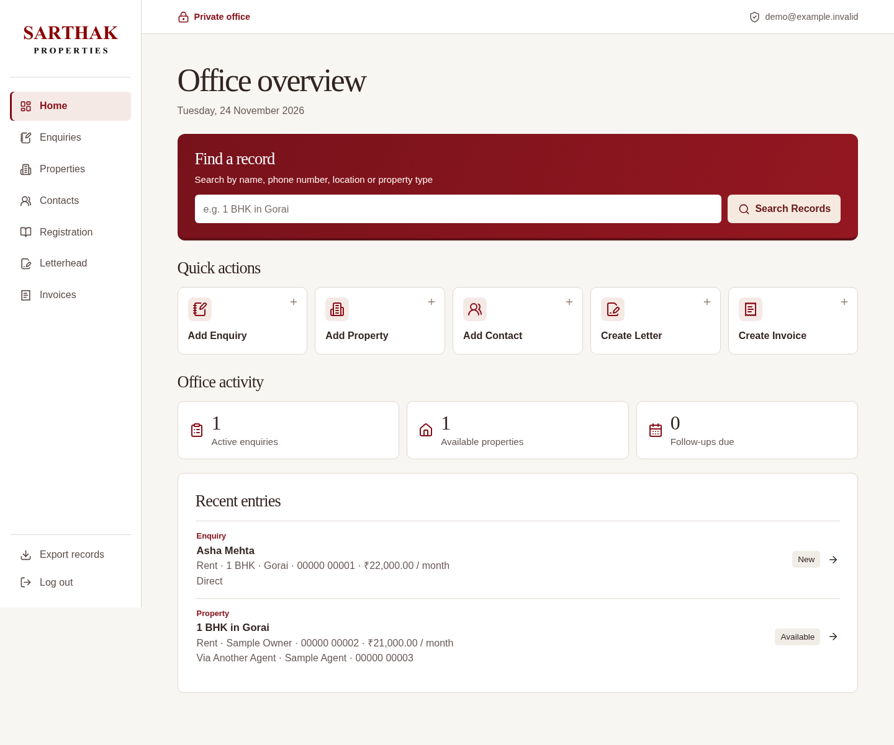
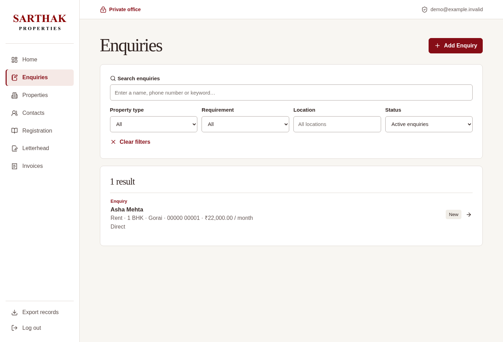
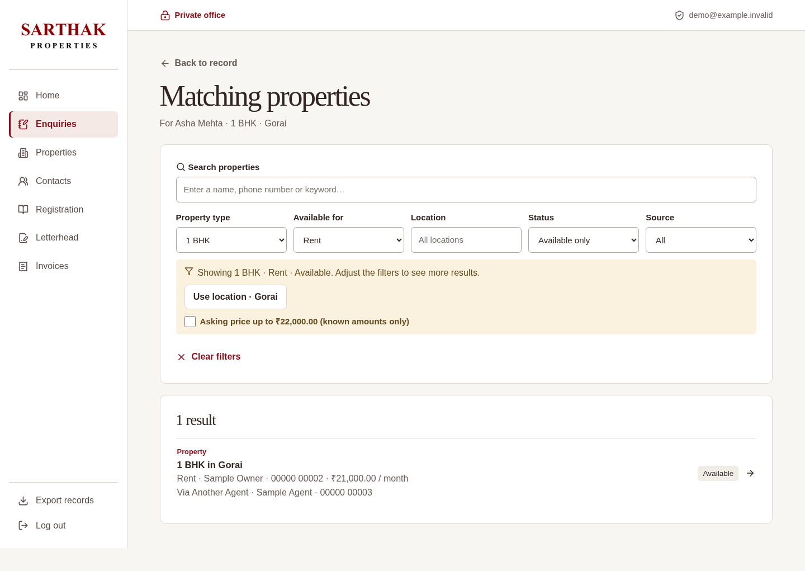

# Sarthak Properties Office Dashboard

A private dashboard built to help a small real estate office move enquiries, available properties, contacts and office paperwork from a notebook into one searchable place.

The primary user is a real estate consultant who is new to computers. The interface uses readable forms, clear actions and simple status labels. The public business website is at [Sarthak Properties](https://sarthak-properties.vercel.app/).

## Screenshots

These screenshots use **fictional demo records**. They were captured from a local demo with simulated API responses. They contain no customer data.

### Office overview

### Enquiries

### Matching properties

## What the dashboard does

- Records enquiries and available properties separately, with rent or sale, property type, location, budget, area unit, source and status.
- Searches names, phone numbers and other recorded details. Filters help find customers looking for a property type or available properties of that type.
- Matches an enquiry with available properties, and finds interested customers for a property. Rent and sale are mapped correctly. The user can also narrow results by location and recorded amount.
- Keeps contacts and a flexible registration register.
- Creates printable A4 letters and invoices, including multiple invoice items and calculated totals.
- Saves records in PostgreSQL. Server-side login checks protect reads, edits and exports.

## Technology

React, TypeScript, Vite and Tailwind CSS for the interface. Vercel Functions and Node.js for the private API. PostgreSQL for records and login sessions. Zod for validation and pdfmake for PDF generation. Vitest and Playwright were used during verification.

## Design and implementation choices

The office views use the supplied Sarthak Properties letterhead as the visual reference. The dashboard route lives alongside the public website. The database and authentication run on the server, with the database connection configured through a server environment variable. The GitHub repository containing the working office application remains private.

This repository is a portfolio overview with fictional screenshots. [View the public business website](https://sarthak-properties.vercel.app/).
